<samp>[linkedin](https://www.linkedin.com/in/ibrahimkarakira/) · [email](mailto:ibrahimkarakira@hotmail.com) · [churnbench](https://github.com/ibrahimkarakira/churnbench)</samp>

 

<samp>THESIS</samp>

I design AI systems that outlive the models they run on.

**Model Half-Life:** the model is the fastest-decaying part of an AI system, so the architecture should make swapping it cheap, safe and provable. I write claims about agent setups as things a tool can check. Design for the swap.

<samp>NOW BUILDING</samp>

**Building in public since November 2026:** [churnbench](https://github.com/ibrahimkarakira/churnbench), a gate that tells you whether your agent setup survives the next model upgrade. More tools follow as they ship.
